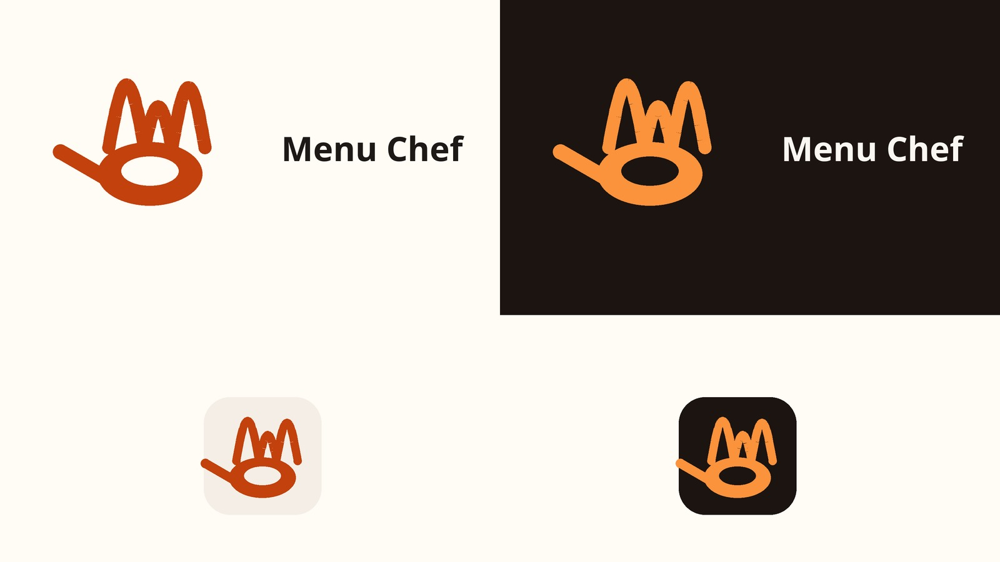

# Logo do Menu Chef

Diretriz de marca da plataforma, não do cardápio de cada restaurante. A casa continua com o próprio logo no cardápio público, como já está em [cores-e-paletas.md](cores-e-paletas.md). O logo descrito aqui é o do Menu Chef: painel, site, ícone do aplicativo e favicon.

A decisão está no topo. Os quatro conceitos seguintes ficam como histórico. Os SVG em [logos/](logos/) são rascunhos anteriores. Não são arte final, e a fonte deles é um substituto do sistema.

## Decisão: Concha com vapor

Escolha do dono em **21 de novembro de 2026**. É uma evolução do conceito Concha: a tigela continua, e o vapor entra para escrever um m.

O quadro acima mostra a referência do conceito: versão clara, versão escura e o símbolo sozinho no ícone. Não é arte final. A imagem anexada na conversa não estava disponível como arquivo neste ambiente; o JPEG reproduz o mesmo arranjo e as cores pedidas. A letra do quadro é Noto Sans Bold, só para segurar o nome no lugar. A arte final usa sem serifa humanista semibold, não essa fonte de sistema.

**Símbolo.** Concha de cozinha. A tigela é redonda e preenchida em `#C2410C`, com o miolo na cor do fundo, para se ler como vasilha e não como mancha. O cabo sai para baixo, à esquerda, curto e com ponta redonda. Da tigela sobem curvas de vapor, no mesmo laranja, que juntas formam um **m** minúsculo. O m liga o desenho à palavra Menu. Não é chama, não é coroa e não tem rosto.

**Lettering.** “Menu Chef”, caixa alta e baixa, sem serifa humanista, peso semibold. No claro, `#1C1917` sobre `#FFFBF5`. No escuro, `#FAF6F1` sobre `#1C1410`. As duas palavras no mesmo peso. “Menu” leva acento.

**Cores do símbolo.** No claro, `#C2410C`. No escuro, `#FB923C`. O `#C2410C` sobre `#1C1410` fica em 3,51:1, pouco para o desenho pequeno. O `#FB923C` sobre o mesmo fundo fica em 8,02:1. O nome no creme fica em 16,96:1. O nome no escuro fica em 16,87:1. O amarelo `#F59E0B` não entra no logo.

**Versões.** Horizontal: símbolo à esquerda, nome à direita, alinhados pelo centro, como no quadro. Ícone de aplicativo e favicon: só o símbolo, sem o nome. Monocromática: o mesmo desenho em `#1C1917` sobre claro, ou em `#FAF6F1` sobre escuro.

**Cuidados para a arte final.**

- Em 16 px o vapor some ou vira ruído. Nesse tamanho, o símbolo fica só a concha, ou só o m se ele ainda se ler como letra. Não manter as três curvas se elas virarem três riscos.
- O m precisa continuar letra. Se o traço engrossar ou ganhar ponta, parece chama, coroa ou o clichê de “comida quente”. Vapor é curva redonda, da mesma cor da tigela, sem fagulha e sem amarelo no meio.
- O miolo da tigela usa a cor do fundo. Uma segunda cor dentro da vasilha vira outro símbolo.
- Contraste AA nos pares acima. Não usar `#C2410C` em cima do fundo escuro.
- O ícone leva só o símbolo. O nome não entra no favicon.
- Não aproximar do sorriso do iFood, do robô da Anota AI, do g azul da Goomer, da letra balão da Saipos nem do fantasma do Aiqfome. A tabela mais abaixo continua valendo.

## O que o logo precisa aguentar

- **Pequeno.** O símbolo sozinho tem de ser reconhecível em favicon e ícone, por volta de 16 px. Detalhe interno (olho, sorriso, letra miúda, vapor com três curvas) some nesse tamanho.
- **Fundo claro e fundo escuro.** No claro, símbolo `#C2410C` e lettering `#1C1917` sobre `#FFFBF5` ou branco. No escuro da paleta Brasa (`#1C1410`), o `#C2410C` sobre o fundo fica em **3,51:1**: passa folgado só para elemento gráfico grande, e é pouco para o desenho pequeno. No modo escuro o símbolo usa `#FB923C` (8,02:1 sobre `#1C1410`) e o lettering usa `#FAF6F1` (16,87:1).
- **Uma cor só.** Versão monocromática em `#1C1917` sobre claro e em `#FAF6F1` sobre escuro, para impressora térmica, carimbo e fundo fotográfico.
- **Respiro.** Em volta do conjunto, um vazio do tamanho da altura da tigela do símbolo (ou da altura da letra M, se for só o nome). Nada de slogan, sombra ou ícone de rede social encostado.
- **Não deformar.** Sem esticar, sem contorno, sem gradiente, sem 3D. O guia reproduzido do iFood repete a mesma regra para a marca deles; vale aqui pelo mesmo motivo, a leitura.
- **Nome legível.** “Menu” leva acento. Abaixo do tamanho em que o acento ainda se vê, usa-se só o símbolo. “Chef” não vai em letra de caligrafia: script vira mancha no ícone e é o clichê de chapéu de cozinheiro.

A paleta de trabalho é a **Brasa clara**. As outras paletas de [cores-e-paletas.md](cores-e-paletas.md) só entram se a marca mudar de recomendação: Horta trocaria a primária para `#166534`, Forno para `#9A3412`, Mesa para `#881337`. O desenho não depende disso.

## O que não copiar

| Marca | O que a pesquisa viu | O que o Menu Chef não faz |
| --- | --- | --- |
| iFood | Vermelho `#EA1D2C`, sorriso no “oo” e seta, no guia de identidade reproduzido | Sorriso, seta, bolha de conversa, esse vermelho |
| Consumer | Vermelho `#F42717` dominante na home | O mesmo escarlate como única cor da marca. A interação deles é referência; a tinta não é |
| Anota AI | Robô em linha e nome em caixa baixa, na descrição pública do logo; a home atual é azul `#0098FC` | Robô, olho, antena, azul de aplicativo |
| Goomer | Logo tipográfico azul; o guia deles diz que a letra g pode ser a redução | Monograma de uma letra só, em azul |
| Saipos | Wordmark azul cobalto, letras pesadas e arredondadas (`#286EFF`, `#280E59` no HTML) | Letra balão, ligatura de brinquedo, azul como cor principal |
| Aiqfome | Fantasma com mordida e roxo, segundo o fundador em entrevista | Fantasma, mordida, roxo como cor da marca |

Também ficam de fora o chapéu de chef com rosto, o garfo cruzado com a faca e a pimenta sorrindo. São ícones genéricos de “comida” e não separam o Menu Chef de um aplicativo de receita.

## Histórico dos conceitos

Estes quatro estudos vieram antes da escolha. A Concha simples é a origem da Concha com vapor. Dobra, Brasa e Tabuleta não foram escolhidos.

## Conceito 1. Concha

**Ideia.** A ferramenta do cozinheiro, não o chapéu. A concha é o gesto de servir, que é o que o sistema faz: tira o pedido da sacola e entrega na cozinha.

**Símbolo.** Uma tigela redonda, traço grosso e constante, e um cabo curto saindo do canto superior direito, levemente inclinado. A tigela não tem rosto, brilho nem comida dentro. Em 16 px sobra um círculo e um traço, ainda legível. Não é colher de chá de lado (parece um relógio) nem concha de feijão com muito detalhe.

**Lettering.** Sem serifa humanista, peso médio (por volta de 500 a 600), caixa alta e baixa: “Menu Chef”. As duas palavras no mesmo peso. Abertura generosa, sem letra geométrica redonda demais (isso puxa para Saipos e Goomer) e sem condensar até parecer um app de cupom. Espaço entre as palavras equivalente a um pouco mais que a largura da letra i.

**Versões.** Horizontal: símbolo à esquerda, nome à direita, alinhados pelo centro. Símbolo sozinho no ícone, dentro de um quadrado com o creme `#FFFBF5` ou, no escuro, com o fundo `#1C1410` e a concha em `#FB923C`. Monocromática: o mesmo desenho em uma cor só.

**Cores.** Tigela e cabo em `#C2410C` no claro. Nome em `#1C1917` no claro e `#FAF6F1` no escuro. O amarelo `#F59E0B` não entra no logo: branco em cima dele fica em 2,15:1, e amarelo de destaque é selo de promoção, não marca.

**Prós.** Diz cozinha sem desenhar um cozinheiro. Aguenta tamanho pequeno. Usa a Brasa sem repetir o vermelho do iFood. **Contras.** Concha é um utensílio comum; o traço precisa ser grosso e o cabo curto, senão vira ícone de banco de ilustração. Não diz “cardápio” à primeira vista. O nome ao lado resolve.

Rascunho: [logos/concha.svg](logos/concha.svg).

## Conceito 2. Dobra

**Ideia.** O produto é um cardápio. A dobra é o papel do cardápio de mesa, reduzido a dois planos.

**Símbolo.** Dois retângulos de canto levemente arredondado, o da frente em `#C2410C` e o de trás em `#44403C`, deslocados para a direita e para baixo, como uma folha dobrada. Sem linha de texto fingida dentro da capa: em tamanho pequeno vira sujeira. A proporção é mais alta do que larga, para não parecer um cartão de crédito.

**Lettering.** Serifa contemporânea de contraste baixo, peso regular, caixa alta e baixa. É a letra de um cardápio impresso, não a de um painel. “Menu Chef” numa linha só. A serifa diferencia dos wordmarks sem serifa e azuis dos sistemas.

**Versões.** Horizontal com o símbolo à esquerda. Símbolo sozinho: os dois retângulos, sem a serifa (a serifa não sobrevive no favicon). Monocromática: os dois planos em duas espessuras do mesmo preto, ou os dois em `#C2410C` se o fundo for claro e a sobreposição ainda se perceber pelo deslocamento.

**Cores.** Frente `#C2410C`, verso `#44403C`, nome `#1C1917`. No escuro, frente `#FB923C`, verso `#FDBA74`, nome `#FAF6F1`.

**Prós.** Fala “cardápio” antes de falar “cozinha”. A serifa afasta o Menu Chef do bloco azul de Goomer, Saipos e Anota AI. **Contras.** Dois retângulos parecem o ícone genérico de “copiar” ou de documento. Sem o nome ao lado, a marca fica ambígua. É o conceito mais fraco como favicon.

Rascunho: [logos/dobra.svg](logos/dobra.svg).

## Conceito 3. Brasa

**Ideia.** O nome da paleta vira o símbolo: uma brasa vista de cima, quente, sem chama de desenho animado.

**Símbolo.** Um quadrado de cantos bem arredondados, quase uma pastilha, em `#C2410C`. Um corte reto no topo, pequeno, quebra o círculo e impede que vire botão ou sol. Sem fagulha, sem língua de fogo, sem sorriso no meio. O corte é o único detalhe, e ainda se vê em 16 px.

**Lettering.** Sem serifa, peso médio, caixa alta e baixa, um pouco mais aberta que o texto de interface, no jeito de uma tabuleta de rua. Não é caixa baixa contínua: “menu chef” todo em minúscula aproxima o desenho do wordmark da Saipos e da Goomer.

**Versões.** Horizontal. Símbolo sozinho é a pastilha com o corte: funciona como favicon melhor do que a Dobra. Monocromática sem o corte colorido; o corte continua sendo um vazio, não uma segunda cor.

**Cores.** Pastilha `#C2410C` no claro e `#FB923C` no escuro. Nome como na Concha. O miolo não leva `#F59E0B`: um ponto amarelo no centro vira olho.

**Prós.** É o mais simples de reproduzir e o mais ligado à paleta recomendada. **Contras.** Brasa abstrata pode parecer um app de aquecimento, de energia ou um botão de gravar. Não tem nada de comida até o nome entrar. Muitas marcas de hambúrguer já usam chama; o corte reto é o que evita a chama, e é fácil um redesenho “melhorar” e cair no clichê.

Rascunho: [logos/brasa.svg](logos/brasa.svg).

## Conceito 4. Tabuleta

**Ideia.** A placa na porta do restaurante, pequena, pendurada. É o aviso de “está aberto”, que no produto é a loja aceitando pedido.

**Símbolo.** Um retângulo horizontal com cantos curtos, em `#C2410C`, e um triângulo mínimo em cima, em `#44403C`, como o gancho da placa. Sem texto dentro da placa e sem seta. O triângulo não pode crescer até parecer a seta do iFood nem um chapéu.

**Lettering.** A mesma sem serifa humanista da Concha, peso médio, caixa alta e baixa. A tabuleta já é o “letreiro”; o nome não precisa de outra voz.

**Versões.** Horizontal: a placa à esquerda do nome, não em cima (em cima o conjunto fica alto demais para cabeçalho). Símbolo sozinho: placa e gancho. Monocromática: placa e gancho na mesma cor; o gancho se separa pelo espaço, não por uma segunda tinta.

**Cores.** Placa `#C2410C`, gancho `#44403C`, nome `#1C1917`. No escuro, placa `#FB923C`, gancho `#FDBA74`, nome `#FAF6F1`.

**Prós.** Diz estabelecimento aberto, que é o estado que o cliente procura. **Contras.** Placa pendurada é símbolo comum de “loja” em mapa. O triângulo compete com seta e com chapéu se o desenhista exagerar. Em favicon, o gancho some e sobra um retângulo mudo.

Rascunho: [logos/tabuleta.svg](logos/tabuleta.svg).

## Recomendação

A recomendação anterior, a Concha sem vapor, foi substituída em 21/11/2026 pela **Concha com vapor**, descrita no topo. Dobra, Brasa e Tabuleta ficam só no histórico.

Promoção e status não usam o logo. Usam o amarelo, o verde, o âmbar, o vermelho e o azul já definidos nas cores.
